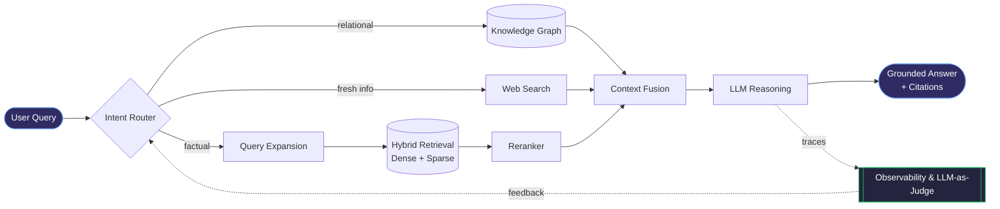
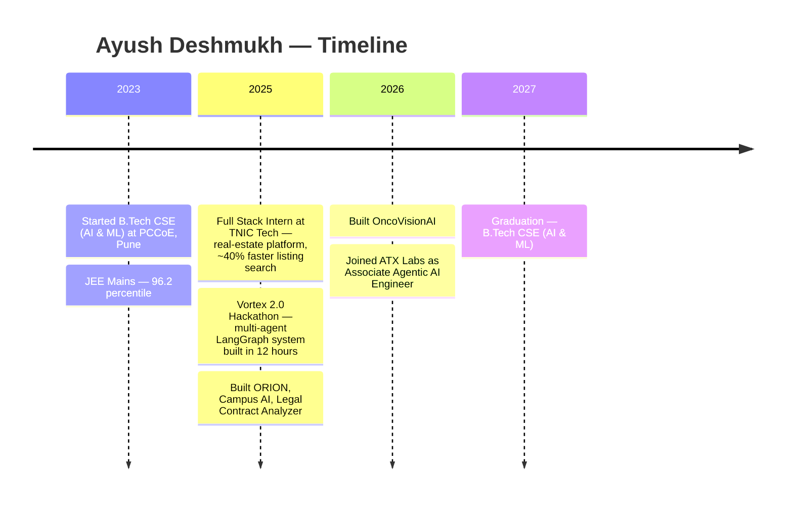

<div align="center">


[](https://git.io/typing-svg)

<br/>

[](https://linkedin.com/in/ayush-deshmukh-a764b73a2)
[](https://github.com/AyushDeshmukh18)
[](mailto:deshmukhaj2005@gmail.com)


</div>

---

## `$ whoami`

```yaml
name        : Ayush Deshmukh
role        : Associate Agentic AI Engineer @ ATX Labs  (Jul 2026 – Present)
education   : B.Tech CSE (AI & ML) — PCCoE, Pune | Final Year | Class of 2027
location    : Pune, Maharashtra, India
focus_areas :
  - Agentic AI & Multi-Agent Orchestration
  - Agentic / Multilingual RAG with Knowledge Graphs
  - LLM Evaluation, Observability & Reliability
  - LLM Fine-tuning & Context Engineering
  - Full-Stack AI Product Development (FastAPI · React · MERN)
currently   : Architecting production agentic RAG for government information systems
open_to     : Open-source contributions · Research collaborations · Ambitious AI projects
```

> *I don't just build models — I architect systems that reason, retrieve, and act end-to-end. From multi-agent research pipelines to grounded, citation-aware RAG over government data, every system I ship is designed to be measurable, observable, and reliable.*

---

## 🧭 What I'm Working On Right Now

<table>
<tr>
<td width="50%" valign="top">

### 💼 Day job — ATX Labs
Architecting an **agentic, multilingual RAG system** for Maharashtra government information:

- Qdrant **hybrid retrieval** + **Knowledge Graphs**
- **Intent-driven query routing**, query expansion & reranking
- **Web fusion** for grounded, **citation-aware** responses
- Multi-stage reasoning with **frontier-model fusion** & document lineage

</td>
<td width="50%" valign="top">

### 📏 Evaluation & Observability
Engineering the pipelines that *prove* the system works:

- **Langfuse** tracing & observability
- **LLM-as-a-Judge** evaluation
- Measuring **retrieval quality**, **tool-calling accuracy**, **agentic behavior** and **response reliability**

</td>
</tr>
</table>

---

## 🏗️ How I Think About Agentic RAG

A simplified view of the architecture pattern I work with:



---

## ⚙️ Technology Arsenal

<div align="center">

### 🤖 AI · ML · Deep Learning


### 🧠 Agentic AI · LLMs · RAG


### 📏 Evaluation · Observability


### 🗄️ Databases · Vector Stores · Graph


### 🌐 Web · Backend · Automation


### 🛠️ Languages · Tools


</div>

<details>
<summary><b>📚 Full skill map (click to expand)</b></summary>

<br/>

| Domain | Skills |
|:--|:--|
| **Languages** | Python · C++ · JavaScript · TypeScript |
| **AI / ML** | Machine Learning · Deep Learning · LLMs · NLP · Generative AI · Explainable AI · LLM Fine-tuning · AI Evaluation |
| **Agentic AI & RAG** | LangChain · LangGraph · LlamaIndex · CrewAI · Multi-Agent Systems · Ollama · Context Engineering · Multimodal & Advanced RAG · Graph RAG · Prompt Engineering |
| **Evaluation & Observability** | DeepEval · LangSmith · Langfuse · LLM-as-a-Judge |
| **Frameworks** | Transformers · Hugging Face · TensorFlow · Scikit-learn · Pandas · NumPy · OpenCV |
| **Automation & Tools** | n8n · Model Context Protocol · FastAPI · Claude Code · GitHub |
| **Data** | Qdrant · Neo4j · MongoDB · PostgreSQL · Redis · Vector Databases |
| **Web** | MERN Stack (MongoDB, Express.js, React.js, Node.js) |
| **CS Core** | Data Structures & Algorithms · DBMS · OOPs · Cloud Computing |

</details>

---

## 🚀 Flagship Projects

<table>
<tr>
<td width="50%" valign="top">

### 🔭 ORION — Multi-Agent Deep Research System
Multi-agent pipeline that automates scientific research end-to-end: research planning, live literature retrieval (ArXiv / Semantic Scholar / Tavily / PDFs), multi-stage summarization, **proposer–critic debate** and structured gap analysis — producing publish-ready drafts with full **citation provenance**.

**Highlights:** persistent sessions · IEEE/APA/ACM formats · claim–evidence linkage · reproducible exports · interactive timelines · Deep RAG chat

`LangGraph` `FastAPI` `React` `ArXiv API` `Semantic Scholar` `Deep RAG`

</td>
<td width="50%" valign="top">

### 🩺 OncoVisionAI — AI-Powered Cancer Detection
End-to-end oncology intelligence platform for cancer screening and diagnostic support from medical images — deep-learning inference, preprocessing and **explainability workflows** in a single pipeline.

**Highlights:** configurable model orchestration · comparative inference · confidence scoring · longitudinal case tracking · exportable, reproducible evaluation

`Python` `FastAPI` `TypeScript` `React` `Deep Learning` `OpenCV`

</td>
</tr>
<tr>
<td width="50%" valign="top">

### 🎓 Campus AI — Autonomous Learning Platform
Converts **50+ syllabus PDFs** into structured interactive courses with hierarchical notes, quizzes and study timelines via citation-grounded, hallucination-resistant RAG — cutting study prep time by **~45%**.

**Highlights:** personalized learning-path generator over the course graph · weak-area detection · automated scheduling & notifications · YouTube recommendations · **~30%** efficiency gain in pilot

`RAG` `LLM` `NLP` `React` `YouTube Data API`

</td>
<td width="50%" valign="top">

### ⚖️ Legal Contract Analyzer
**7-agent CrewAI pipeline** automating review of 500+ contracts — Parser → Classifier → Risk Assessor → Precedent Matcher → Citation → Explainability → Q&A.

**Impact:** 60% less manual effort · 35% better retrieval accuracy

`CrewAI` `LlamaIndex` `Neo4j` `Legal-BERT` `Graph RAG`

</td>
</tr>
<tr>
<td width="50%" valign="top">

### 🤖 Resume ATS Automation Agent
Autonomous job-application system — tailors resumes & cover letters per role, detects ATS platforms, fills forms with Playwright, and queues jobs asynchronously with graceful failure handling.

`LangGraph` `Playwright` `Celery` `Redis` `Ollama`

</td>
<td width="50%" valign="top">

### 📡 AI Content Intelligence Platform
Monitors **50+ live AI sources** (arXiv, Reddit, YouTube, HF Hub), processes **300+ articles/day**, builds a Neo4j knowledge graph of **1,000+ entities**, and auto-generates multi-channel content behind LLM quality gates.

`n8n` `Neo4j` `llama3:70b` `Whisper` `PostgreSQL`

</td>
</tr>
<tr>
<td colspan="2" valign="top">

### ⚽ Sports Video Analytics Pipeline
End-to-end computer-vision system with persistent player tracking across occlusions, Re-ID via embedding similarity, heatmaps, bird's-eye projection, team clustering and per-player speed estimation.

`YOLOv8/v9` `OpenCV` `Kalman Filter` `Streamlit` `ffmpeg`

</td>
</tr>
</table>

> 🔗 Source code for every project is on my [GitHub profile](https://github.com/AyushDeshmukh18?tab=repositories).

---

## 🛣️ Journey



<details>
<summary><b>💼 Experience & 🏆 Achievements (click to expand)</b></summary>

<br/>

**Associate Agentic AI Engineer — ATX Labs** *(July 2026 – Present)*
- Architecting an agentic, multilingual RAG system for Maharashtra government information (Qdrant hybrid retrieval, Knowledge Graphs, intent-driven routing, query expansion, reranking, web fusion).
- Engineering multi-stage LLM reasoning & evaluation pipelines with frontier-model fusion, document lineage, Langfuse observability and LLM-as-a-Judge evaluation.

**Full Stack Intern — TNIC Tech**
- Built a real-estate platform feature set that reduced listing search time by ~40%.

**🏆 Vortex 2.0 — 12-Hour Hackathon** *(DYP DPU, Pune · Society for Data Science · Sept 24–25, 2025)*
- Built and deployed a multi-agent system end-to-end in 12 hours: LangGraph supervisor agent orchestrating specialized sub-agents with shared-state communication and dynamic workflow routing, a RAG-backed retrieval layer and a Streamlit UI — against competitive teams from multiple institutions.

**🎓 Education — PCCoE, Pune**
- B.Tech CSE (AI & ML Specialization), graduating 2027 · JEE Mains 96.2 percentile.

</details>

---

## 📊 GitHub Analytics

<div align="center">


<br/>


<br/>


</div>

---

## 🏅 Highlights

<div align="center">

| | Achievement |
|:---:|:---|
| 💼 | **Associate Agentic AI Engineer @ ATX Labs** — agentic multilingual RAG for government information |
| 🏆 | **Vortex 2.0 Hackathon** — shipped a LangGraph multi-agent system in 12 hours |
| 📊 | **JEE Mains — 96.2 Percentile** |
| 🧪 | Fine-tuned LLMs, built multimodal RAG, deployed multi-agent systems |
| 📈 | Impact delivered: **~45%** less study prep · **60%** less contract-review effort · **~40%** faster listing search |
| 🌐 | Open to open-source contributions & research collaborations |

</div>

---

## 📬 Let's Connect

<div align="center">

*Always happy to talk agentic AI, RAG, evaluation, research ideas or open-source collaboration.*

<br/>

[](https://linkedin.com/in/ayush-deshmukh-a764b73a2)
&nbsp;
[](mailto:deshmukhaj2005@gmail.com)
&nbsp;
[](https://github.com/AyushDeshmukh18)

<br/>

*⭐ If something here is useful, a star on a repo goes a long way.*


</div>
